# Database ERD

This reflects `database/migrations/` as implemented. Relationship lines show the principal domain paths; the tables below include every table created by the migrations. Columns shown are identifiers and the fields most relevant to relationships and legal records. The migrations define the full column types, nullability, indexes, and foreign keys.

```mermaid
erDiagram
    COMPANIES ||--o{ BRANCHES : owns
    COMPANIES ||--o{ USERS : employs
    COMPANIES ||--o{ COMMITTEE_MANDATES : issues
    COMPANIES ||--o{ COMPANY_SEQUENCES : numbers
    COMPANIES ||--o{ LAWS : internal_regulations
    COMPANIES ||--o{ COMPANY_HR_PARTNER : engages
    HR_PARTNERS ||--o{ COMPANY_HR_PARTNER : serves
    COMPANIES ||--o{ COMPANY_LAW_FIRM_PARTNER : engages
    LAW_FIRM_PARTNERS ||--o{ COMPANY_LAW_FIRM_PARTNER : serves
    BRANCHES ||--o{ LOCATIONS : contains
    BRANCHES ||--o{ EMPLOYEES : employs
    BRANCHES ||--o{ BRANCH_USER : grants_access
    USERS ||--o{ BRANCH_USER : assigned
    COMMITTEE_MANDATES ||--o{ COMMITTEE_POOL_MEMBERS : defines
    EMPLOYEES ||--o{ COMMITTEE_POOL_MEMBERS : may_link
    BRANCHES ||--o{ VIOLATION_REPORTS : receives
    VIOLATION_REPORTS ||--o{ REPORT_WITNESSES : records
    VIOLATION_REPORTS |o--o| CASES : converts_to
    EMPLOYEES ||--o{ CASES : subject
    CASES ||--o{ CASE_WITNESSES : records
    CASES ||--o{ CASE_EVENTS : logs
    CASES ||--o{ CASE_LINKS : links
    CASES ||--o{ COMMITTEE_SESSION_ATTENDANCES : holds
    COMMITTEE_POOL_MEMBERS ||--o{ COMMITTEE_SESSION_ATTENDANCES : attends
    CASES ||--o| APPEAL_TRACKINGS : tracks
    CASES ||--o{ DOCUMENTS : produces
    DOCUMENTS ||--o{ DOCUMENT_CONTENTS : renders
    DOCUMENTS ||--o{ DOCUMENT_APPROVALS : receives
    DOCUMENTS |o--o{ SIGNATURES : signed_on
    DOCUMENTS ||--o{ CITATIONS : contains
    LEGAL_UNITS ||--o{ CITATIONS : supports
    LAWS ||--o{ LAW_JURISDICTIONS : applies_in
    LAWS ||--o{ LEGAL_UNITS : contains
    CASES |o--o{ AI_GENERATION_LOGS : records
    USERS |o--o{ AUDIT_LOGS : acts

    COMPANIES {
        bigint id PK
        string name
        json enabled_languages
        string subscription_status
        boolean is_active
    }
    HR_PARTNERS {
        bigint id PK
        string name
        string contact_email
    }
    LAW_FIRM_PARTNERS {
        bigint id PK
        string name
        string contact_email
    }
    COMPANY_HR_PARTNER {
        bigint company_id PK,FK
        bigint hr_partner_id PK,FK
        boolean full_case_access
    }
    COMPANY_LAW_FIRM_PARTNER {
        bigint company_id PK,FK
        bigint law_firm_partner_id PK,FK
    }
    USERS {
        bigint id PK
        bigint company_id FK
        bigint employee_id FK
        string primary_role
        string name
        string email
        string password
        boolean is_active
    }
    BRANCHES {
        bigint id PK
        bigint company_id FK
        string name
        string jurisdiction
        boolean is_active
    }
    LOCATIONS {
        bigint id PK
        bigint company_id FK
        bigint branch_id FK
        string name
        boolean is_active
    }
    EMPLOYEES {
        bigint id PK
        bigint company_id FK
        bigint branch_id FK
        string employee_code
        string name
        string department
        string position
        date hire_date
        boolean is_general_manager
    }
    BRANCH_USER {
        bigint id PK
        bigint company_id FK
        bigint branch_id FK
        bigint user_id FK
    }
    COMMITTEE_MANDATES {
        bigint id PK
        bigint company_id FK
        string order_number
        date order_date
        date effective_from
        timestamp superseded_at
    }
    COMMITTEE_POOL_MEMBERS {
        bigint id PK
        bigint company_id FK
        bigint mandate_id FK
        bigint branch_id FK
        bigint employee_id FK
        bigint user_id FK
        string role_type
        string person_name
    }
    VIOLATION_REPORTS {
        bigint id PK
        bigint company_id FK
        bigint branch_id FK
        bigint reporter_user_id FK
        bigint employee_id FK
        bigint location_id FK
        bigint case_id FK
        string status
    }
    REPORT_WITNESSES {
        bigint id PK
        bigint company_id FK
        bigint violation_report_id FK
        bigint employee_id FK
        string name
    }
    CASES {
        bigint id PK
        bigint company_id FK
        bigint branch_id FK
        bigint employee_id FK
        bigint violation_report_id FK
        bigint law_version_id FK
        bigint committee_mandate_id FK
        int case_number
        string status
        timestamp defense_letter_issued_at
    }
    CASE_WITNESSES {
        bigint id PK
        bigint company_id FK
        bigint case_id FK
        bigint employee_id FK
        string name
    }
    CASE_EVENTS {
        bigint id PK
        bigint company_id FK
        bigint case_id FK
        bigint actor_user_id FK
        string event_type
        json payload
        timestamp created_at
    }
    CASE_LINKS {
        bigint id PK
        bigint company_id FK
        bigint case_id FK
        bigint linked_case_id FK
        string link_type
    }
    COMMITTEE_SESSION_ATTENDANCES {
        bigint id PK
        bigint company_id FK
        bigint case_id FK
        bigint committee_pool_member_id FK
        boolean is_chair
        string vote
    }
    APPEAL_TRACKINGS {
        bigint id PK
        bigint company_id FK
        bigint case_id FK
        date window_start
        date window_end
        boolean appeal_filed
    }
    ATTACHMENTS {
        bigint id PK
        bigint company_id FK
        string attachable_type
        bigint attachable_id
        string kind
        string disk
        string path
        bigint uploaded_by FK
    }
    DOCUMENTS {
        bigint id PK
        bigint company_id FK
        bigint case_id FK
        bigint previous_version_id FK
        bigint superseded_by_id FK
        string document_type
        int version
        string status
        boolean is_locked
        string reference_number
        smallint reference_year
        boolean reference_is_manual
    }
    DOCUMENT_CONTENTS {
        bigint id PK
        bigint company_id FK
        bigint document_id FK
        string language_code
        longtext body
        boolean is_authoritative
    }
    DOCUMENT_APPROVALS {
        bigint id PK
        bigint company_id FK
        bigint document_id FK
        bigint approver_user_id FK
        string role_category
        string decision
        json languages_present
        timestamp invalidated_at
    }
    SIGNATURES {
        bigint id PK
        bigint company_id FK
        bigint case_id FK
        bigint document_id FK
        bigint employee_id FK
        bigint committee_pool_member_id FK
        string purpose
        string status
        string presence_check
    }
    CITATIONS {
        bigint id PK
        bigint company_id FK
        bigint document_id FK
        bigint legal_unit_id FK
        string relevance_check
        boolean overridden
    }
    COMPANY_SEQUENCES {
        bigint id PK
        bigint company_id FK
        string sequence_key
        smallint year
        int next_value
    }
    LAWS {
        bigint id PK
        bigint company_id FK
        string kind
        string name
        string number
        smallint year
        string source_file_path
        string approval_status
    }
    LAW_JURISDICTIONS {
        bigint law_id PK,FK
        string jurisdiction PK
    }
    LEGAL_UNITS {
        bigint id PK
        bigint law_id FK
        bigint company_id FK
        bigint previous_version_id FK
        bigint superseded_by_id FK
        int version
        string article_number
        string clause_path
        text official_text
        string status
    }
    AUDIT_LOGS {
        bigint id PK
        bigint company_id FK
        bigint actor_user_id FK
        string action
        string entity_type
        bigint entity_id
        json metadata
    }
    AI_GENERATION_LOGS {
        bigint id PK
        bigint company_id FK
        bigint case_id FK
        bigint document_id FK
        bigint actor_user_id FK
        string touchpoint
        string model
        longtext input
        longtext output
        string status
    }

    PASSWORD_RESET_TOKENS {
        string email PK
        string token
        timestamp created_at
    }
    SESSIONS {
        string id PK
        bigint user_id
        longtext payload
        int last_activity
    }
    CACHE {
        string key PK
        mediumtext value
        bigint expiration
    }
    CACHE_LOCKS {
        string key PK
        string owner
        bigint expiration
    }
    JOBS {
        bigint id PK
        string queue
        longtext payload
        smallint attempts
    }
    JOB_BATCHES {
        string id PK
        string name
        int total_jobs
        int pending_jobs
    }
    FAILED_JOBS {
        bigint id PK
        string uuid
        longtext payload
        longtext exception
    }
    PERMISSIONS {
        bigint id PK
        string name
        string guard_name
    }
    ROLES {
        bigint id PK
        string name
        string guard_name
    }
    MODEL_HAS_PERMISSIONS {
        bigint permission_id PK,FK
        string model_type PK
        bigint model_id PK
    }
    MODEL_HAS_ROLES {
        bigint role_id PK,FK
        string model_type PK
        bigint model_id PK
    }
    ROLE_HAS_PERMISSIONS {
        bigint permission_id PK,FK
        bigint role_id PK,FK
    }
```

## Integrity notes

- Tenant children carry `company_id` directly. Their tenant parent references use composite foreign keys such as `(company_id, branch_id) -> branches(company_id, id)`. Users remain outside the fail-closed model scope so authentication can locate them; authorization must check role and company.
- `laws.company_id` is null for platform statutes. `law_jurisdictions` is a many-to-many applicability setting. No legal units are seeded until verified extraction; only verified units may be cited.
- `documents` and `legal_units` version through previous/superseded row IDs. `document_contents` stores language variants; there is no content snapshot column. Official document reference numbers are assigned at issuance. `company_sequences` also tracks case and employee numbers.
- MySQL triggers protect append-only events, audit and AI logs, attachments, locked documents and their contents/citations, approvals, and verified legal units. Production MySQL needs `log_bin_trust_function_creators=1` to create the triggers.
- `attachments` is polymorphic (`attachable_type`, `attachable_id`), so its target has no database foreign key. The Laravel cache, queue, session, and Spatie permission tables are included because their migrations create them.
