# Database ERD

This reflects `database/migrations/` as implemented. Relationship lines show the principal domain paths; the tables below include every table created by the migrations. Columns shown are identifiers and the fields most relevant to relationships and legal records. The migrations define the full column types, nullability, indexes, and foreign keys.

The `cases` BEFORE UPDATE trigger refuses status changes unless `CaseWorkflow` sets `@displanery_workflow_transition = 1` for its transaction. `case_alerts` is a retryable outbox; `case_events` remains append-only.

```mermaid
erDiagram
    COMPANIES ||--o{ BRANCHES : owns
    COMPANIES ||--o{ USERS : employs
    COMPANIES ||--o{ COMMITTEE_MANDATES : issues
    COMPANIES ||--o{ COMPANY_SEQUENCES : numbers
    COMPANIES ||--o{ LAWS : internal_regulations
    COMPANIES ||--o{ COMPANY_HR_PARTNER : engages
    HR_PARTNERS ||--o{ COMPANY_HR_PARTNER : serves
    COMPANIES ||--o{ COMPANY_LAW_FIRM_PARTNER : engages
    LAW_FIRM_PARTNERS ||--o{ COMPANY_LAW_FIRM_PARTNER : serves
    BRANCHES ||--o{ LOCATIONS : contains
    BRANCHES ||--o{ EMPLOYEES : employs
    BRANCHES ||--o{ BRANCH_USER : grants_access
    USERS ||--o{ BRANCH_USER : assigned
    COMMITTEE_MANDATES ||--o{ COMMITTEE_POOL_MEMBERS : defines
    EMPLOYEES ||--o{ COMMITTEE_POOL_MEMBERS : may_link
    BRANCHES ||--o{ VIOLATION_REPORTS : receives
    VIOLATION_REPORTS ||--o{ REPORT_WITNESSES : records
    VIOLATION_REPORTS |o--o| CASES : converts_to
    EMPLOYEES ||--o{ CASES : subject
    CASES ||--o{ CASE_WITNESSES : records
    CASES ||--o{ CASE_EVENTS : logs
    CASES ||--o{ CASE_ALERTS : queues
    CASES ||--o{ CASE_CONFLICT_CLEARANCES : records
    COMMITTEE_POOL_MEMBERS ||--o{ CASE_CONFLICT_CLEARANCES : cleared_for
    CASES ||--o{ CASE_LINKS : links
    CASES ||--o{ COMMITTEE_SESSION_ATTENDANCES : holds
    COMMITTEE_POOL_MEMBERS ||--o{ COMMITTEE_SESSION_ATTENDANCES : attends
    CASES ||--o| APPEAL_TRACKINGS : tracks
    CASES ||--o{ DOCUMENTS : produces
    DOCUMENTS ||--o{ DOCUMENT_CONTENTS : renders
    DOCUMENTS ||--o{ DOCUMENT_APPROVALS : receives
    DOCUMENTS |o--o{ SIGNATURES : signed_on
    DOCUMENTS ||--o{ CITATIONS : contains
    LEGAL_UNITS ||--o{ CITATIONS : supports
    LAWS ||--o{ LAW_JURISDICTIONS : applies_in
    LAWS ||--o{ LEGAL_UNITS : contains
    LAWS ||--o{ LEGAL_IMPORT_RUNS : imports
    LEGAL_IMPORT_RUNS ||--o{ LEGAL_IMPORT_PAGES : renders
    LEGAL_IMPORT_RUNS ||--o{ LEGAL_UNITS : builds
    LEGAL_UNITS ||--o| LEGAL_UNIT_APPROVALS : approved_by_reviewer
    CASES |o--o{ AI_GENERATION_LOGS : records
    USERS |o--o{ AUDIT_LOGS : acts
    USERS ||--o{ REPORT_EXPORTS : requests
    COMPANIES |o--o{ REPORT_EXPORTS : scopes

    COMPANIES {
        bigint id PK
        string name
        json enabled_languages
        string subscription_status
        boolean is_active
    }
    HR_PARTNERS {
        bigint id PK
        string name
        string contact_email
    }
    LAW_FIRM_PARTNERS {
        bigint id PK
        string name
        string contact_email
    }
    COMPANY_HR_PARTNER {
        bigint company_id PK,FK
        bigint hr_partner_id PK,FK
        boolean full_case_access
    }
    COMPANY_LAW_FIRM_PARTNER {
        bigint company_id PK,FK
        bigint law_firm_partner_id PK,FK
    }
    USERS {
        bigint id PK
        bigint company_id FK
        bigint employee_id FK
        string primary_role
        string name
        string email
        string password
        boolean is_active
    }
    REPORT_EXPORTS {
        bigint id PK
        bigint company_id FK
        bigint requested_by FK
        string report_type
        json parameters
        string format
        string status
        string file_path
        string file_sha256
        datetime ready_at
        datetime expires_at
    }
    BRANCHES {
        bigint id PK
        bigint company_id FK
        string name
        string jurisdiction
        boolean is_active
    }
    LOCATIONS {
        bigint id PK
        bigint company_id FK
        bigint branch_id FK
        string name
        boolean is_active
    }
    EMPLOYEES {
        bigint id PK
        bigint company_id FK
        bigint branch_id FK
        string employee_code
        string name
        string department
        string position
        date hire_date
        boolean is_general_manager
    }
    BRANCH_USER {
        bigint id PK
        bigint company_id FK
        bigint branch_id FK
        bigint user_id FK
    }
    COMMITTEE_MANDATES {
        bigint id PK
        bigint company_id FK
        string order_number
        date order_date
        date effective_from
        timestamp superseded_at
    }
    COMMITTEE_POOL_MEMBERS {
        bigint id PK
        bigint company_id FK
        bigint mandate_id FK
        bigint branch_id FK
        bigint employee_id FK
        bigint user_id FK
        string role_type
        string person_name
    }
    VIOLATION_REPORTS {
        bigint id PK
        int report_number "Sequential per company"
        bigint company_id FK
        bigint branch_id FK
        bigint reporter_user_id FK
        bigint employee_id FK
        bigint location_id FK
        bigint case_id FK
        boolean place_unknown
        boolean when_unknown
        string status
    }
    REPORT_WITNESSES {
        bigint id PK
        bigint company_id FK
        bigint violation_report_id FK
        bigint employee_id FK
        string name
    }
    CASES {
        bigint id PK
        bigint company_id FK
        bigint branch_id FK
        bigint employee_id FK
        bigint violation_report_id FK
        bigint law_version_id FK
        bigint committee_mandate_id FK
        int case_number
        string status
        timestamp defense_letter_issued_at
        boolean session_majority_reached
        bigint legal_review_requested_by FK
        timestamp legal_review_requested_at
        bigint legal_review_completed_by FK
        timestamp legal_review_completed_at
        text legal_review_note
    }
    CASE_WITNESSES {
        bigint id PK
        bigint company_id FK
        bigint case_id FK
        bigint employee_id FK
        string name
    }
    CASE_EVENTS {
        bigint id PK
        bigint company_id FK
        bigint case_id FK
        bigint actor_user_id FK
        string event_type
        json payload
        timestamp created_at
    }
    CASE_ALERTS {
        bigint id PK
        bigint company_id FK
        bigint case_id FK
        string alert_type
        string stage
        string status
        int attempts
        text last_error
        timestamp sent_at
    }
    CASE_CONFLICT_CLEARANCES {
        bigint id PK
        bigint company_id FK
        bigint case_id FK
        bigint committee_pool_member_id FK
        bigint cleared_by FK
        text reason
        timestamp created_at
    }
    CASE_LINKS {
        bigint id PK
        bigint company_id FK
        bigint case_id FK
        bigint linked_case_id FK
        string link_type
    }
    COMMITTEE_SESSION_ATTENDANCES {
        bigint id PK
        bigint company_id FK
        bigint case_id FK
        bigint committee_pool_member_id FK
        boolean is_chair
        string vote
    }
    APPEAL_TRACKINGS {
        bigint id PK
        bigint company_id FK
        bigint case_id FK
        date window_start
        date window_end
        boolean appeal_filed
    }
    ATTACHMENTS {
        bigint id PK
        bigint company_id FK
        string attachable_type
        bigint attachable_id
        string kind
        string disk
        string path
        bigint uploaded_by FK
    }
    DOCUMENTS {
        bigint id PK
        bigint company_id FK
        bigint case_id FK
        bigint previous_version_id FK
        bigint superseded_by_id FK
        string document_type
        int version
        string status
        boolean is_locked
        string reference_number
        smallint reference_year
        boolean reference_is_manual
        bigint leave_confirmed_by FK
        timestamp leave_confirmed_at
    }
    DOCUMENT_CONTENTS {
        bigint id PK
        bigint company_id FK
        bigint document_id FK
        string language_code
        longtext body
        boolean is_authoritative
    }
    DOCUMENT_APPROVALS {
        bigint id PK
        bigint company_id FK
        bigint document_id FK
        bigint approver_user_id FK
        bigint committee_pool_member_id FK
        string role_category
        string decision
        json languages_present
        timestamp invalidated_at
    }
    SIGNATURES {
        bigint id PK
        bigint company_id FK
        bigint case_id FK
        bigint document_id FK
        bigint employee_id FK
        bigint committee_pool_member_id FK
        string purpose
        string status
        string presence_check
    }
    CITATIONS {
        bigint id PK
        bigint company_id FK
        bigint document_id FK
        bigint legal_unit_id FK
        string relevance_check
        boolean overridden
    }
    COMPANY_SEQUENCES {
        bigint id PK
        bigint company_id FK
        string sequence_key
        smallint year
        int next_value
    }
    LAWS {
        bigint id PK
        bigint company_id FK
        string kind
        string category
        string name
        string number
        smallint year
        string source_file_path
        string approval_status
        string import_mode
        boolean requires_page_range
        bigint supersedes_law_id FK
        string source_sha256
    }
    LAW_JURISDICTIONS {
        bigint law_id PK,FK
        string jurisdiction PK
    }
    LEGAL_UNITS {
        bigint id PK
        bigint law_id FK
        bigint company_id FK
        bigint previous_version_id FK
        bigint superseded_by_id FK
        int version
        string article_number
        string clause_path
        text official_text
        string status
        bigint import_run_id FK
        int source_page
        text extraction_a
        text extraction_b
        bigint verified_by FK
        timestamp verified_at
        json tags
    }
    LEGAL_IMPORT_RUNS {
        bigint id PK
        bigint law_id FK
        bigint company_id FK
        string source_path
        string source_sha256
        int page_from
        int page_to
        string mode
        string state
        json counts
        bigint started_by FK
        text error
        timestamp started_at
        timestamp finished_at
    }
    LEGAL_IMPORT_PAGES {
        bigint id PK
        bigint run_id FK
        bigint company_id FK
        int page_number
        string image_path
        string image_sha256
        string text_status
        string text_method
        longtext text
        string ai_status
        longtext ai_text
        boolean ai_illegible
        int attempts_text
        int attempts_ai
        text last_error
    }
    LEGAL_UNIT_APPROVALS {
        bigint id PK
        bigint company_id FK
        bigint legal_unit_id FK
        bigint approved_by FK
        timestamp created_at
    }
    AUDIT_LOGS {
        bigint id PK
        bigint company_id FK
        bigint actor_user_id FK
        string action
        string entity_type
        bigint entity_id
        json metadata
    }
    AI_GENERATION_LOGS {
        bigint id PK
        bigint company_id FK
        bigint case_id FK
        bigint document_id FK
        bigint actor_user_id FK
        string touchpoint
        string model
        longtext input
        longtext output
        string status
    }

    PASSWORD_RESET_TOKENS {
        string email PK
        string token
        timestamp created_at
    }
    SESSIONS {
        string id PK
        bigint user_id
        longtext payload
        int last_activity
    }
    CACHE {
        string key PK
        mediumtext value
        bigint expiration
    }
    CACHE_LOCKS {
        string key PK
        string owner
        bigint expiration
    }
    JOBS {
        bigint id PK
        string queue
        longtext payload
        smallint attempts
    }
    JOB_BATCHES {
        string id PK
        string name
        int total_jobs
        int pending_jobs
    }
    FAILED_JOBS {
        bigint id PK
        string uuid
        longtext payload
        longtext exception
    }
    PERMISSIONS {
        bigint id PK
        string name
        string guard_name
    }
    ROLES {
        bigint id PK
        string name
        string guard_name
    }
    MODEL_HAS_PERMISSIONS {
        bigint permission_id PK,FK
        string model_type PK
        bigint model_id PK
    }
    MODEL_HAS_ROLES {
        bigint role_id PK,FK
        string model_type PK
        bigint model_id PK
    }
    ROLE_HAS_PERMISSIONS {
        bigint permission_id PK,FK
        bigint role_id PK,FK
    }
```

## Integrity notes

### Report exports (2026-10-08)

`report_exports` stores `company_id` (nullable only for Platform Admin all-company periodic or hotspot reports), `requested_by` (users FK), `report_type`, JSON `parameters`, `format`, `status` (`queued`, `ready`, `failed`, `expired`, `revoked`), private `file_path`, `file_sha256`, `error`, `ready_at`, `expires_at`, and timestamps. The application model enforces the nullable company rule and tenant scope. A company-scoped export may be owned by a cross-company Platform Admin or HR partner, so `requested_by` is a single users FK; access is checked by role and company at request, generation, and download. Ready files expire seven days after generation.

### AI drafting and citation review (2026-10-08)

| Table | Added fields or relationship | Rule |
|---|---|---|
| `laws` | Nullable `name_en` | English citation rendering falls back to the Arabic name. |
| `cases` | `ai_request_id`, `ai_request_document_type`, `ai_request_from_status`, `ai_request_started_at` | A request token ties a queued job to its case state; stale workers cannot save. |
| `citations` | `claim_hash`, `override_reason` | One row per Arabic claim and unit. An override requires a recorded reason. |
| `ai_draft_notes` | `company_id`, `case_id`, `document_id`, `ai_generation_log_id`, JSON `notes`, `created_at` | Append-only notes stay outside the issued document. |
| `legal_unit_topics` | `legal_unit_id`, `topic`, `created_by`, `created_at` | Topics can change without editing verified legal text. Current versions only. |

`documents.drafted_by` distinguishes AI drafts from manual drafts. `ai_generation_logs` and `case_events` retain the append-only history of requests, saves, failures, checks, and overrides.

### Document template and rendering additions (2026-10-05)

| Table | Added fields and relationships | Rule |
|---|---|---|
| `company_letterheads` | `company_id`, `language_code`, `version`, `name`, `address_lines`, `phone`, `email`, `footer_text`, `header_mode`, `logo_path`, `logo_sha256`, `header_image_path`, `header_image_sha256`, `needs_review`, `created_by`, `created_at` | Unique company/language/version; append-only. Images live on the private disk under `letterheads/{company}/{sha256}.{ext}`. |
| `document_templates` | `company_id`, `document_type`, `language_code`, `version`, `blocks` JSON, `options` JSON, `created_by`, `created_at` | Unique company/type/language/version; append-only. No row means the code default applies. |
| `documents` | `render_snapshot` JSON, `rendered_html` longtext, `pdf_status`, `pdf_error`, `pdf_sha256` | HTML and snapshot freeze at issuance. The PDF job reads only frozen HTML; the private PDF path and hash are set once. |
| `document_contents` | `secondary_body` nullable text | Recommendations store findings in `body` and recommendations in `secondary_body`. Locked content is immutable. |
| `employees` | `gender`, nullable `name_en`, `position_en`, `department_en` | Male or female is required for new UI entries and document issuance. English fields fall back to Arabic source values. |
| `committee_pool_members` | nullable `person_name_en` | Used on English document pages for members without a linked employee; falls back to `person_name`. |

The existing `companies.letterhead_logo_path`, `letterhead_address`, `letterhead_phone`, and `letterhead_email` columns are deprecated. Current settings are versioned in `company_letterheads`; the old columns are retained for migration compatibility.

Dashboard settings on `companies`: `hotspot_min_cases` (unsigned tiny integer, default 3; validated 2–50) and `hotspot_window_days` (unsigned small integer, default 90; validated 7–365). Dashboard and notification deadline hours both use the global `displanery.deadlines.approaching_hours` setting.

Dashboard indexes on `cases`: `(company_id, status)`, `(company_id, violation_time)`, `(company_id, branch_id, violation_time)`, and `(company_id, defense_letter_issued_at)`. Incident periods use `violation_time`; procedure metrics use the defense and completion dates.

`cases.violation_time_known` is a boolean defaulting to true. When false, `violation_time` stores the reported date at 00:00 as a database value only; screens and generated text show the date and indicate that the time was not stated.

- Tenant children carry `company_id` directly. Their tenant parent references use composite foreign keys such as `(company_id, branch_id) -> branches(company_id, id)`. Users remain outside the fail-closed model scope so authentication can locate them; authorization must check role and company.
- `users.primary_role` is one of `platform_admin`, `company_admin`, `hr_staff`, `dept_manager`, `reporter`, `committee_member`, `external_legal_reviewer`, or `hr_partner_staff`. The legacy `company_legal_reviewer` value migrates to an inactive `reporter`.
- Spatie permissions add abilities, not primary roles: `review_internal_regulation` and `view_all_company_cases` live in `permissions` and `model_has_permissions` with the `web` guard. Teams mode is off.
- `laws.company_id` is null for platform statutes. `law_jurisdictions` is a many-to-many applicability setting. No legal units are seeded until verified extraction; only verified units may be cited.
- Legal imports keep immutable content-addressed source files in `legal_import_runs`, private page images and independent readings in `legal_import_pages`, and the producing `import_run_id` on each unit. `legal_unit_approvals` records one company lawyer approval per regulation unit. `laws.requires_page_range` marks gazettes that contain multiple laws; `supersedes_law_id`, `import_mode`, and `source_sha256` record applicability and source provenance.
- `documents` and `legal_units` version through previous/superseded row IDs. `document_contents` stores language variants; issued `documents.rendered_html` and `render_snapshot` freeze the print input and its template/letterhead provenance. Official document reference numbers are assigned at issuance. `company_sequences` also tracks case and employee numbers.
- MySQL triggers protect append-only events, audit and AI logs, attachments, locked documents and their contents/citations, approvals, and verified legal units. Production MySQL needs `log_bin_trust_function_creators=1` to create the triggers.
- `attachments` is polymorphic (`attachable_type`, `attachable_id`), so its target has no database foreign key. The Laravel cache, queue, session, and Spatie permission tables are included because their migrations create them.
- `case_file_intakes` holds a tenant-scoped HR upload set until the draft case is saved. `attachments` may also belong to a `report_assistant_session` until report send. Both intake paths copy append-only attachment rows into case or report evidence while keeping the private file bytes on the local disk. `attachment_texts` holds one immutable extracted reading per attachment, keyed by `(company_id, attachment_id)` and optionally linked to its AI generation log. A failed or reference-only reading has a status with no text.
- `response_transcriptions` stores append-only AI attempts and HR-confirmed text against a response scan. The case stores the confirmed text, checker, timestamp, and origin; a pending correction clears all four before a new confirmation. `(company_id, case_id)`, `(company_id, attachment_id)`, and the optional AI log use composite foreign keys.
- `signature_presence_suggestions` stores append-only per-attendee results for a signed recommendations scan. Committee signature rows bind to that scan through `attachment_id` and optionally to a suggestion through `presence_suggestion_id`; `ai_suggestion` preserves the suggested value. Composite keys keep the suggestion, document, and scan in one tenant.
